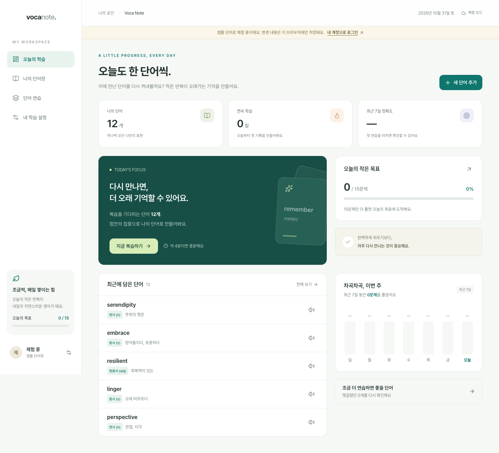
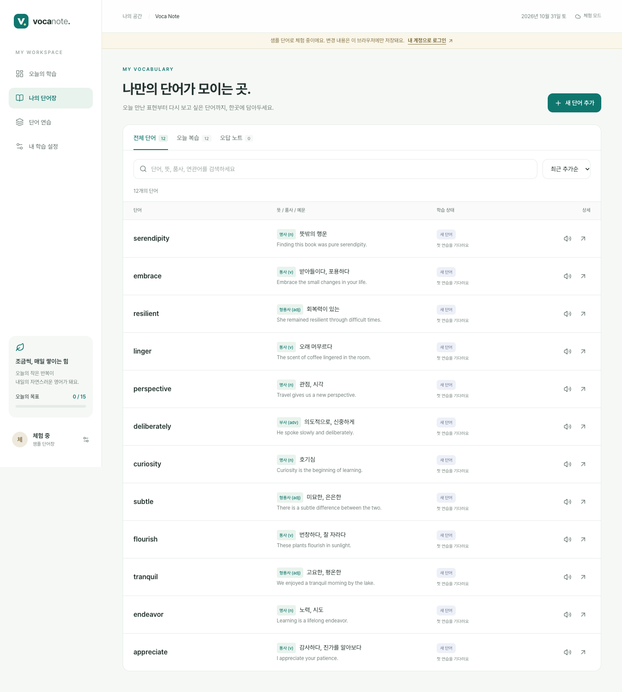
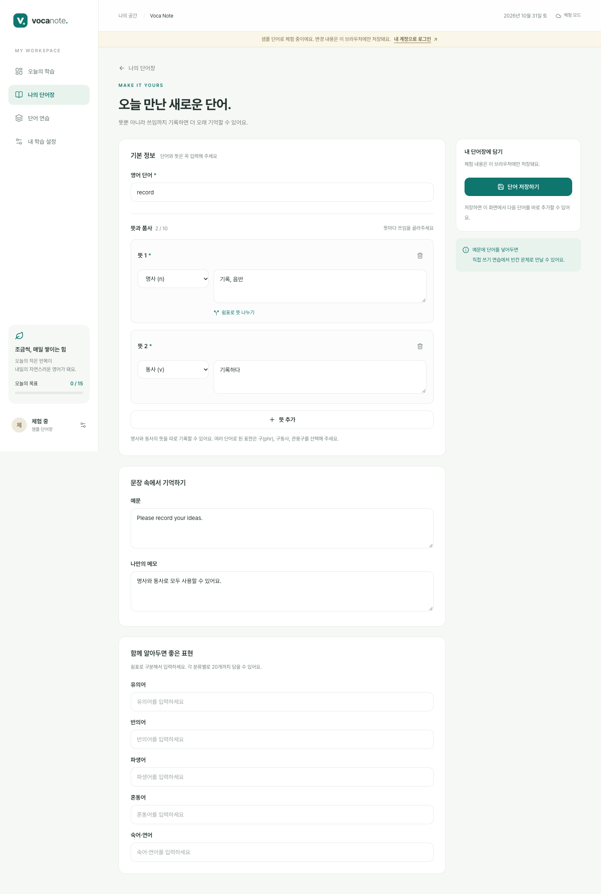
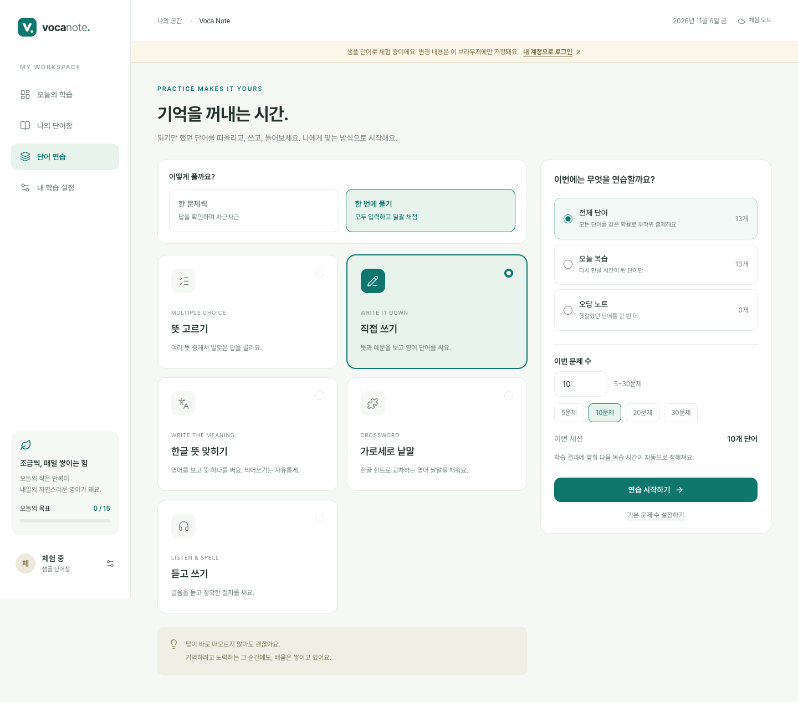
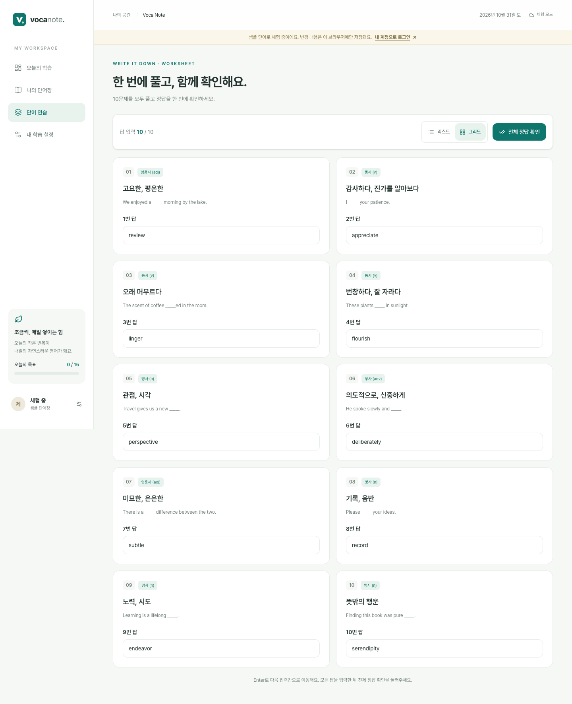
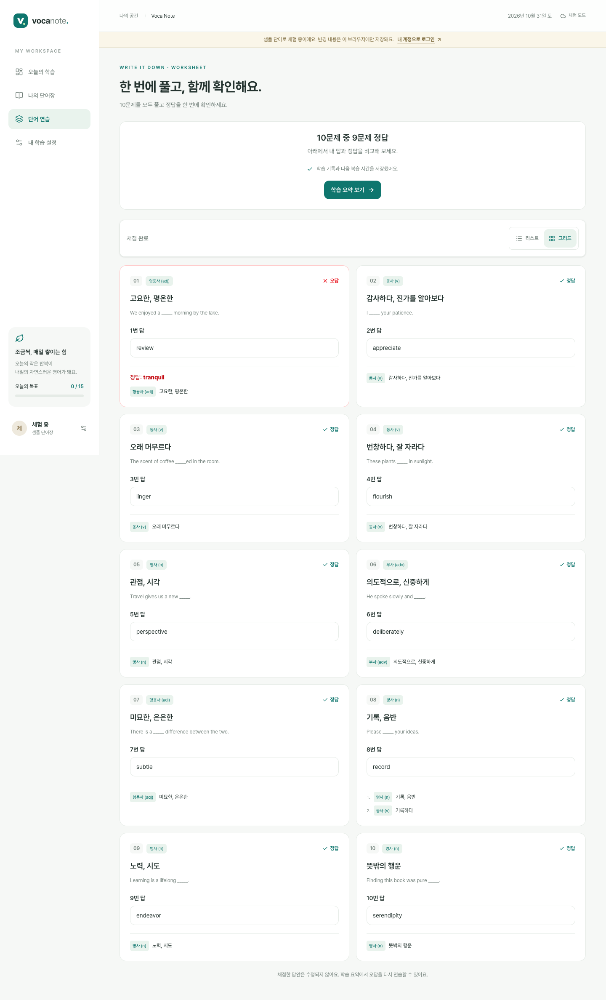
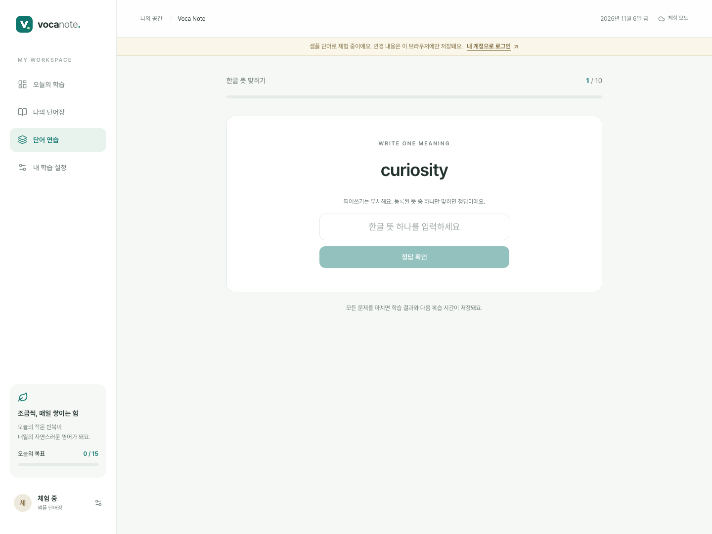
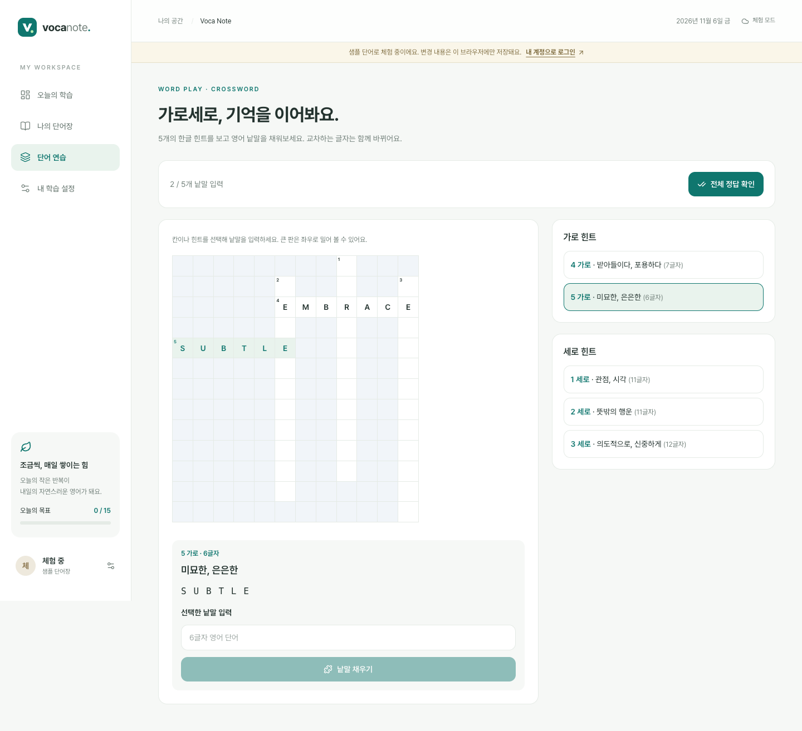

# Voca Note Web

앱에서 모은 단어와 복습 기록을 웹에서 이어가는 개인 영어 학습 공간입니다.

**서비스:** https://voca-note.web.app

기존 `voca-note-1068c.web.app` 주소는 같은 경로의 새 주소로 이동합니다. 새 주소에서는 Google 로그인이 한 번 다시 필요할 수 있습니다. Firebase 계정과 단어 데이터는 같은 프로젝트를 사용합니다.

**저장소:** https://github.com/JeHeeYu/Voca-Note-Web

**Android:** [앱 저장소 · v1.2.0](https://github.com/JeHeeYu/Voca-Note) · [변경 기록](CHANGELOG.md)

React 19 · TypeScript · Vite · Tailwind CSS 4 · Pretendard · Zustand · Firebase Auth / Firestore / Hosting

## 화면

실제 웹 앱의 체험 모드를 촬영했습니다. 아래 화면은 샘플 데이터이며 개인 계정의 단어장을 사용하지 않습니다.

| 오늘의 학습                                    | 나의 단어장                                            |
| ---------------------------------------------- | ------------------------------------------------------ |
|  |  |

### 뜻마다 품사, 원하는 방식으로 연습





| 모두 입력한 뒤 함께 확인                                            | 정답과 오답 비교                                                      |
| ------------------------------------------------------------------- | --------------------------------------------------------------------- |
|  |  |

| 한글 뜻 맞히기                                                      | 가로세로 낱말                                                       |
| ------------------------------------------------------------------- | ------------------------------------------------------------------- |
|  |  |

## 기능

- 앱과 같은 Google 계정으로 로그인, 사용자별 단어·설정·최근 120개 복습 세션 실시간 동기화
- 오늘의 목표, 연속 학습일, 최근 7일 정확도와 학습량
- 단어 추가·수정·삭제, 저장 후 추가 화면 유지, 단어당 최대 10개 뜻과 뜻별 품사
- 기본 8품사와 구(phr)·구동사·관용구·약어, 쉼표로 적은 뜻 나누기, 예문·메모·연관어
- 단어·뜻·품사·예문·연관어 검색, 오늘 복습/오답 필터, 최근/알파벳/우선순 정렬
- 기억 카드에서 모든 뜻 확인, 뜻별 품사를 반영한 뜻 고르기·직접 쓰기, 듣고 쓰기, 오답 재연습
- 정답 확인 후 Enter로 다음 단어 진행, 한 번에 풀기(뜻 고르기·직접 쓰기·듣고 쓰기·한글 뜻 맞히기)
- 연습 화면에서 5~30문제 선택, 세로로 이어지는 문제에 전체 입력 후 일괄 채점·답안 비교·오답 재연습
- 전체 단어는 등록 시점·정답률·복습 예정일에 관계없이 같은 확률로 무작위 출제, 오늘 복습·오답 노트는 해당 범위의 복습 우선순위 유지
- 한글 뜻 맞히기: 영어를 보고 등록된 뜻 하나를 입력, 띄어쓰기·탭·줄바꿈과 유니코드 표기 차이를 무시하며 쉼표·세미콜론·슬래시로 나눈 뜻도 인정
- 가로세로 낱말: 한글 힌트로 연결된 영어 낱말판 완성, 교차 글자 공유, 빈칸 검증, 일괄 채점과 오답 복습
- 앱과 같은 간격 반복: 정답 `1일 → 3일 → 2배(최대 180일)`, 오답 `10분`
- 반응형 화면, 키보드 접근·입력 오류 안내·화면 이탈 경고, 기기 TTS
- JSON 백업과 실제 계정 데이터에 영향을 주지 않는 브라우저 체험 모드

한글 뜻은 입력과 저장된 뜻을 같은 구분자로 나눠 비교하며, 순서와 띄어쓰기는 무시합니다. `보상금, 보상`을 등록했다면 `보상`, `보상금`, `보상, 보상금` 모두 정답입니다. 뜻별로 따로 등록한 경우도 같고, 여러 뜻 중 일부만 입력해도 됩니다. 여러 개를 입력할 때는 입력한 항목이 모두 등록된 뜻이어야 하며, 등록하지 않은 유의어나 활용형은 자동 추측하지 않습니다.

낱말판은 영어 알파벳 2~18글자만 사용하고 공백·하이픈·아포스트로피를 생략합니다. 후보를 무작위로 뽑은 뒤 최대 25×25칸 안에서 실제로 교차하는 단어만 배치하므로 설정한 문제 수보다 적게 나올 수 있습니다. 최소 두 단어가 연결되어야 시작하며, 오답은 영어 직접 쓰기로 다시 연습합니다. 새 모드는 `meaning_writing`, `crossword`로 저장하며 기존 복습 간격과 중복 저장 방지 규칙을 함께 사용합니다.

## 개발

Node.js 22.12 이상을 사용합니다. `.nvmrc`는 Node 22입니다.

```sh
nvm use
npm ci
cp .env.example .env.local
# 기존 Firebase 프로젝트의 웹 앱 설정으로 .env.local을 채웁니다.
npm run dev
```

Google 로그인으로 로컬 확인할 때는 `http://localhost:5173`을 사용하세요. 현재 Firebase 승인 도메인은 `localhost`, `voca-note.web.app`, `voca-note.firebaseapp.com`, `voca-note-1068c.web.app`, `voca-note-1068c.firebaseapp.com`입니다. 다른 주소는 Authentication의 Authorized domains에 추가해야 합니다.

Firebase 설정이 없어도 `먼저 둘러보기`를 통해 샘플 데이터로 화면을 확인할 수 있습니다. 체험 변경 사항은 이 브라우저의 `voca-note:demo:v1`에만 보관됩니다. 실제 계정으로 자동 업로드되지 않습니다.

## 폴더 구조

```text
src/
├── app/                # Provider, 전역 레이아웃 조립
├── router/             # 경로 및 페이지 지연 로딩
├── assets/fonts/       # Pretendard 원본과 OFL 라이선스
├── styles/             # 폰트 선언, Tailwind 디자인 토큰
├── shared/
│   ├── components/     # 버튼, 모달, 이탈 경고, 상태 표시 등
│   ├── hooks/          # 온라인 상태, 현재 시각
│   ├── lib/            # Firebase 초기화, 오류·음성 도구
│   ├── models/         # 앱 공통 데이터 계약, 통계, 간격 반복
│   ├── repositories/   # Firestore / 체험 저장소 구현
│   └── stores/         # 전역 데이터 구독 상태
└── features/
    ├── auth/           # pages, components, stores
    ├── home/           # pages, components
    ├── library/        # pages, hooks
    ├── editor/         # pages, components, models
    ├── review/         # pages, components, hooks, models
    └── settings/       # pages
```

기존 Aione/DeepScan 클라이언트의 기능별 `pages/components/hooks/models/repositories` 구성과 명명 방식을 참고했습니다. 회사 전용 패키지나 인증·서비스 코드는 포함하지 않습니다. 화면은 `VocaRepository` 계약으로 저장하며 Firestore 컬렉션을 직접 다루지 않습니다. 공통 모델은 플랫폼 SDK와 독립적이고, Firestore 시간은 데이터 계층에서 밀리초로 변환합니다.

## 앱과 공유하는 데이터

Firebase 프로젝트: `voca-note-1068c`

```text
users/{uid}/words/{wordId}
users/{uid}/settings/review
users/{uid}/reviewSessions/{sessionId}
```

복습 모드 값과 Timestamp 형식은 Android 앱과 동일합니다. 웹의 단어 뜻은 `meanings: { meaning: string, partOfSpeech: string | null }[]`를 기준으로 읽고 씁니다(1~10개, 뜻마다 300자). `meaning`과 `partOfSpeech` 단일 필드에도 첫 항목을 저장합니다. 기존 단일 뜻 문서는 한 항목으로 읽으며, 쉼표는 사용자가 ‘쉼표로 뜻 나누기’를 누를 때만 분리합니다. 배열이 있으면 단일 필드보다 우선합니다.

품사는 기존 8개 값 외에 `phrase`, `phrasal_verb`, `idiom`, `abbreviation`을 지원합니다. Android 1.1.0부터 같은 구조로 여러 뜻을 읽고 편집합니다. 단일 뜻만 지원하는 구버전 앱은 1.1.0 이상으로 업데이트하세요. 기존 `multipleChoiceCount` 설정도 읽고, 저장할 때 현재 형식으로 정리합니다. 복습 결과는 transaction으로 단어와 세션을 함께 저장합니다. 세션 ID를 유지해 네트워크 재시도가 중복 집계로 이어지지 않으며, 다른 기기에서 삭제된 단어가 있으면 세션 전체 저장을 중단합니다.

`firestore.rules`는 기존 문서를 허용하면서 `meanings`의 항목·길이·품사를 검사합니다. 사용자별 접근 제한은 유지합니다. 스키마 변경을 배포할 때는 검증 후 `firebase deploy --only firestore:rules --project voca-note-1068c`를 먼저 실행하고 Hosting을 배포하세요. 일반 Hosting 배포는 규칙을 변경하지 않습니다. Android 저장소의 규칙도 같은 내용으로 동기화되어 있습니다. 규칙을 수정하면 두 저장소를 함께 갱신하세요.

## 검증

```sh
npm run check             # 타입, ESLint, 단위 테스트, 프로덕션 빌드
npm run test:e2e          # 설치된 Google Chrome에서 브라우저 테스트
npm run test:integration  # Firebase CLI 및 Java 17+ 필요 (CLI 15는 Java 21+)
```

통합 테스트는 `demo-voca-note`와 로컬 포트 `18180`만 사용합니다. 운영 데이터는 읽거나 쓰지 않습니다. 브라우저 테스트는 체험 모드에서 CRUD·6개 복습 모드·Enter 진행·10/20문제 일괄 채점·저장 실패 재시도·설정·모바일·이탈 경고를 검증합니다. 일괄 채점도 기존 복습 세션 형식으로 한 번만 저장하고, 설정 화면의 기본 문제 수를 사용하되 연습 시작 화면에서 이번 분량만 바꿀 수 있습니다. 듣고 쓰기의 음성 호출은 테스트에서 대체하므로 실제 소리 출력 여부는 기기에서 확인해야 합니다.

로그인 UI를 에뮬레이터로 개발할 때는 별도 로컬 환경에서 `VITE_USE_FIREBASE_EMULATORS=true`, 프로젝트 ID `demo-voca-note`를 사용하고 `firebase emulators:start --only auth,firestore --project demo-voca-note`를 실행하세요. Auth는 `19099`, Firestore는 `18180`입니다. 운영 배포에서는 에뮬레이터를 허용하지 않습니다.

GitHub Actions는 PR/main 변경 시 타입·lint·테스트·빌드와 에뮬레이터·브라우저 테스트를 실행합니다. 배포는 아래 명령으로 진행합니다.

## Firebase Hosting 배포

```sh
firebase login
npm run deploy
```

Hosting 대상은 `.firebaserc`의 `web`(새 사이트)과 `legacy`(기존 주소의 경로 유지 리다이렉트)입니다. `npm run deploy`는 두 대상을 함께 배포합니다. 새 사이트만 배포하려면 검증·빌드 후 `firebase deploy --only hosting:web --project voca-note-1068c`를 사용합니다.

배포 전 웹 환경변수와 프로젝트 일치를 검사합니다. `dist`만 Hosting에 배포하며 SPA 경로 새로고침과 정적 파일 캐시를 설정합니다. `.env.local`, Firebase 로그인 정보, 서비스 계정 키는 커밋하지 않습니다. 웹 Firebase 설정은 번들에 포함되는 클라이언트 설정이며, 데이터 접근은 Authentication과 Firestore Rules로 제어됩니다.

## README 이미지 재생성

```sh
node scripts/capture-readme.mjs
# 로컬 화면을 촬영하려면 개발 서버 실행 후:
PLAYWRIGHT_BASE_URL=http://127.0.0.1:5173 node scripts/capture-readme.mjs
```

새 Chrome 세션에서 체험 모드만 사용하고 `docs/screenshots/`에 PNG 8개를 저장합니다. 로그인 정보와 실제 계정 데이터는 사용하지 않습니다. 코드 변경이 없는 문서·이미지 갱신에는 Hosting 재배포가 필요하지 않습니다.

## 참고

- [Tailwind Vite 설치](https://tailwindcss.com/docs/installation/using-vite)
- [Firebase Google 로그인](https://firebase.google.com/docs/auth/web/google-signin)
- [Firebase Hosting](https://firebase.google.com/docs/hosting/quickstart)
- [Pretendard 및 라이선스](https://github.com/orioncactus/pretendard)
